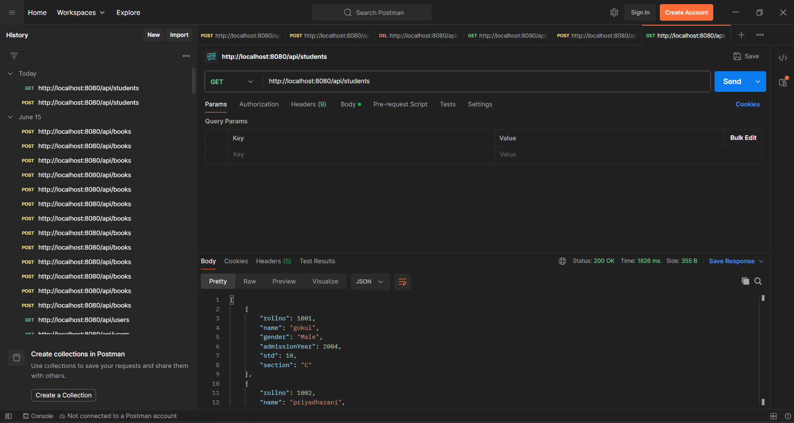
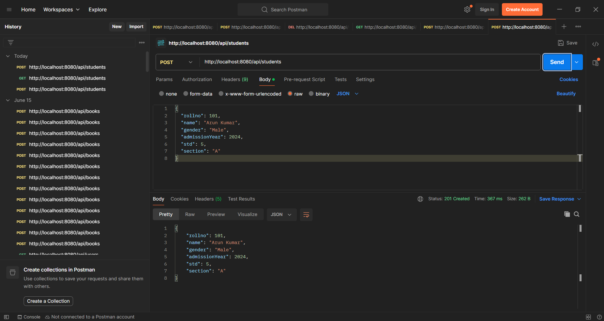
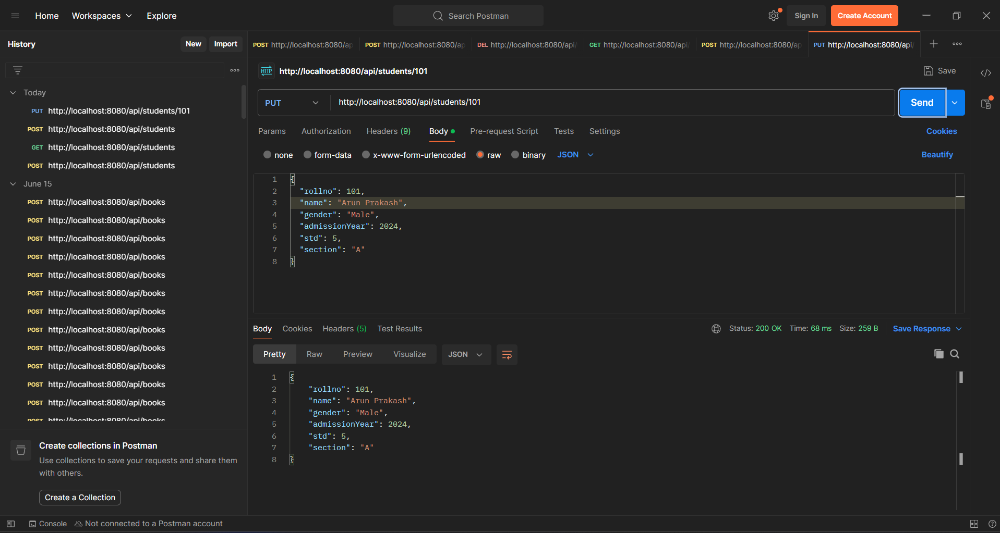
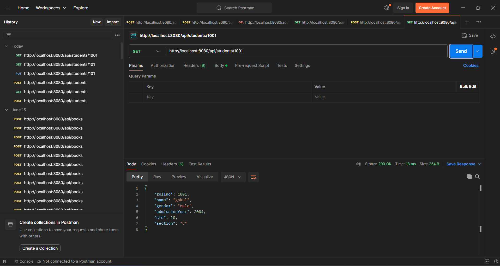
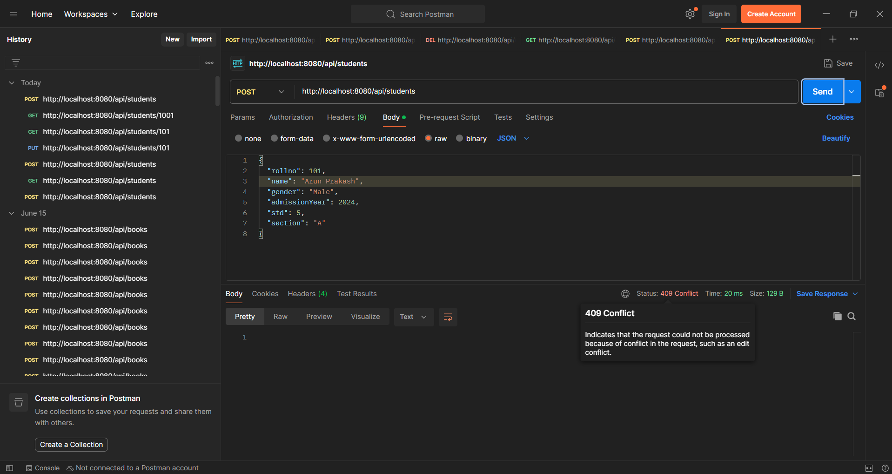

# GSK School – Student Management REST API

A RESTful backend for managing school student records, built with **Spring Boot** and **PostgreSQL** using a clean layered architecture (Controller → Service → Repository → Entity).

  

## Features
- Full CRUD for students (roll number, name, gender, admission year, standard, section)
- Filter students by admission year, or by admission year and standard
- Proper HTTP status codes: `201 Created`, `404 Not Found`, `409 Conflict` for duplicate roll numbers
- CORS enabled for a React frontend (`http://localhost:5173`)
- Spring Data JPA derived queries, with the schema auto-generated by Hibernate

## Tech Stack
Java 17 · Spring Boot · Spring Web · Spring Data JPA · Hibernate · PostgreSQL · Maven

## Project Structure
```
src/main/java/com/example/gsk_school
├── controller/   StudentController      (REST endpoints)
├── service/      StudentService + Impl  (business logic)
├── repository/   StudentRepository      (Spring Data JPA)
├── model/        Student                (JPA entity)
└── GskSchoolApplication.java
```

## API Endpoints
| Method | Endpoint | Description |
|--------|----------|-------------|
| GET | `/api/students` | List all students |
| GET | `/api/students/{rollno}` | Get one student |
| GET | `/api/students/filter/{year}` | Students admitted in a year |
| GET | `/api/students/filter/?year=2024&std=5` | Filter by year and standard |
| POST | `/api/students` | Add a student (409 if roll number exists) |
| PUT | `/api/students/{rollno}` | Update a student |
| DELETE | `/api/students/{rollno}` | Delete a student |

**Sample request body**
```json
{
  "rollno": 101,
  "name": "Arun Kumar",
  "gender": "Male",
  "admissionYear": 2024,
  "std": 5,
  "section": "A"
}
```

## Getting Started
**Prerequisites:** JDK 17+, PostgreSQL

1. Clone the repo
   ```bash
   git clone https://github.com/Gokulkrish24/gsk-school.git
   cd gsk-school
   ```
2. Create the database
   ```sql
   CREATE DATABASE gsk_school;
   ```
3. Set your credentials as environment variables
   ```bash
   export DB_USERNAME=postgres
   export DB_PASSWORD=your_password
   # optional: export DB_URL=jdbc:postgresql://localhost:5432/gsk_school
   ```
4. Run the app
   ```bash
   ./mvnw spring-boot:run
   ```
   The API starts at `http://localhost:8080`.

## Screenshots






## Future Improvements
- Input validation (`@Valid`) and a global exception handler
- DTO layer and pagination
- Swagger/OpenAPI documentation
- Unit and integration tests
- Dockerfile and CI with GitHub Actions

## Author
**V Gokulakrishnan** – [GitHub](https://github.com/Gokulkrish24) · [LinkedIn](https://linkedin.com/in/gokul-krishna)
"# gsk_School_Student-management-REST-API" 
